<div align="center">


# FlyNow

**App móvil para buscar, reservar y gestionar vuelos.**
Un mockup funcional con buena UI/UX, animaciones cuidadas y arquitectura limpia.

[](https://flutter.dev)
[](https://dart.dev)
[](pubspec.yaml)
[](test)
[](analysis_options.yaml)
[](https://bloclibrary.dev)
[](https://pub.dev/packages/go_router)
[](#)
[](lib/l10n/app_es.arb)

</div>

---

## 📱 Pantallas

Trece pantallas, fieles a un prototipo HTML (los textos coinciden con él a ≤ 1.7 px).

| Splash | Iniciar sesión | Inicio | Elige tu vuelo |
|:--:|:--:|:--:|:--:|
|  |  | 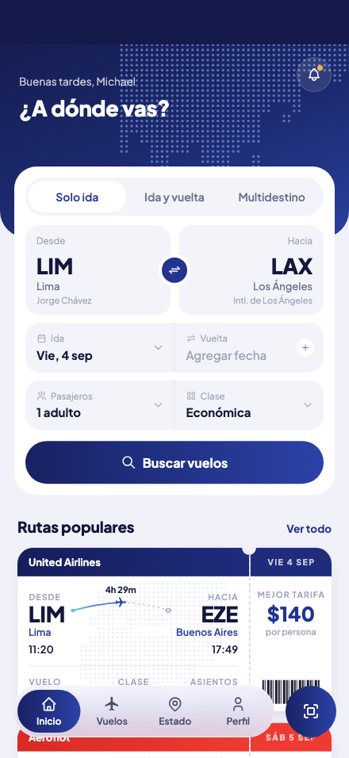 | 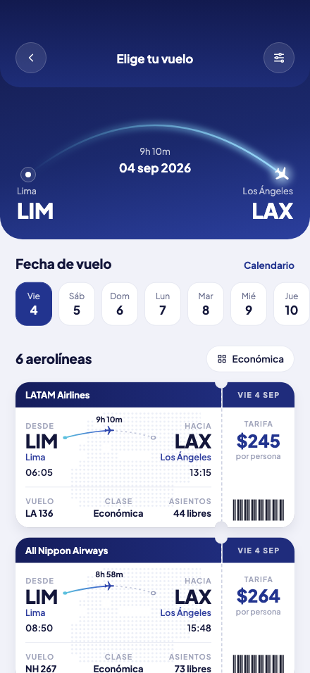 |

| Tarifa | Pasajeros | Asientos | Revisa y paga |
|:--:|:--:|:--:|:--:|
| 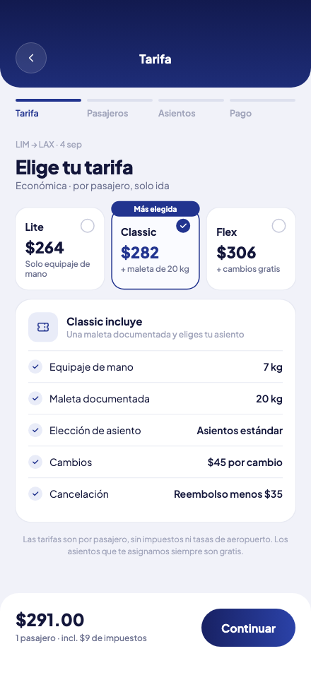 | 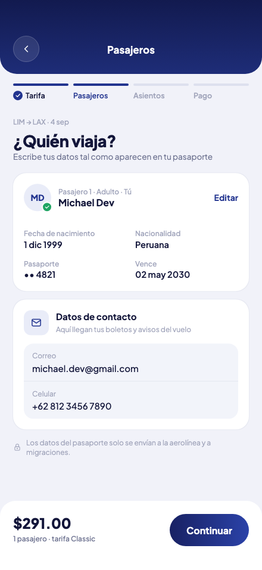 | 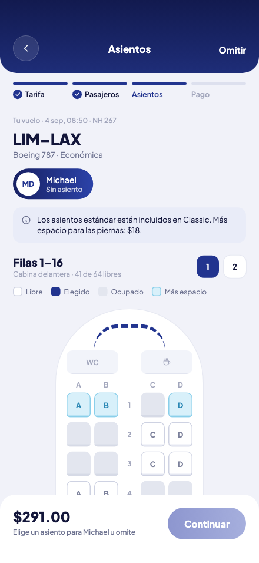 | 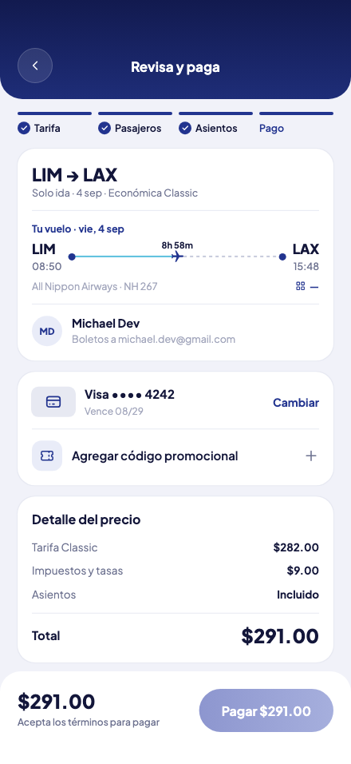 |

| Reserva confirmada | Detalle del viaje | Mis vuelos | Estado de vuelos |
|:--:|:--:|:--:|:--:|
| 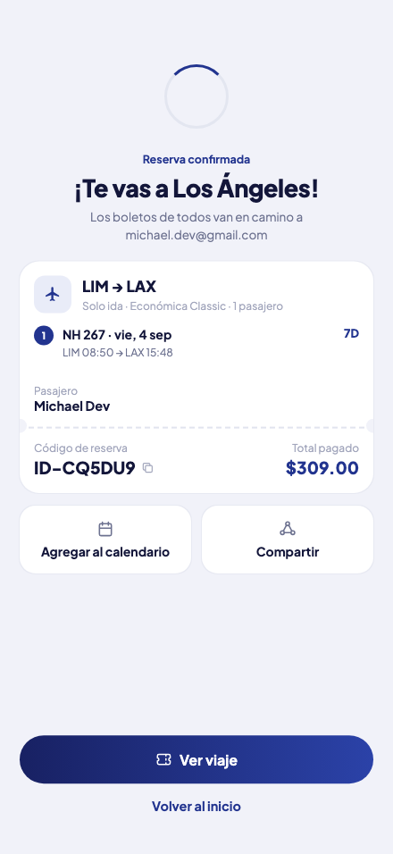 | 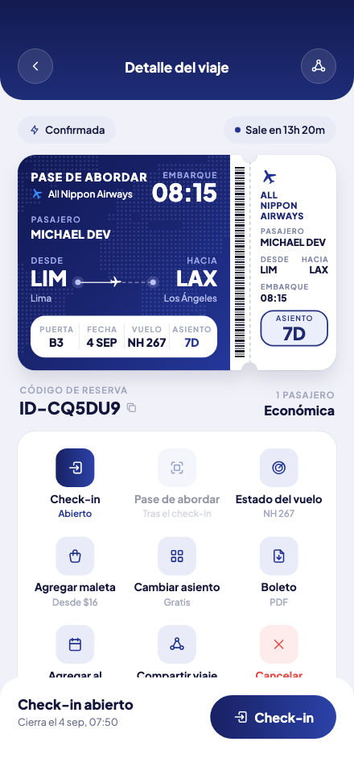 | 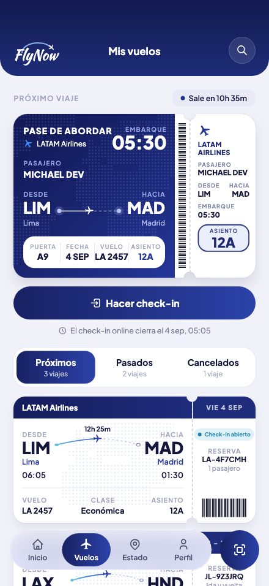 | 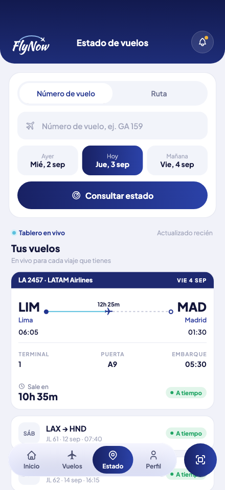 |

| Perfil |
|:--:|
| 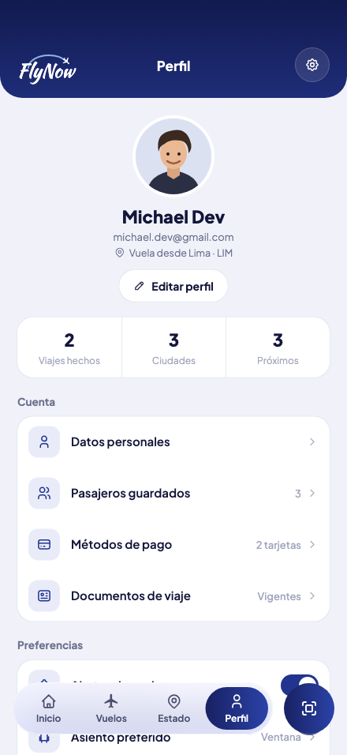 |

## ✨ Qué hace

- **Buscar vuelos** eligiendo origen y destino entre Lima, Los Ángeles, Tokio, Buenos Aires, Madrid, Moscú y Pekín. Los resultados cambian según la ruta: duración, horas locales de llegada, precios y aerolíneas coherentes con la distancia, presentados como boletos con perforación.
- **Comprar en 4 pasos:** tarifa (Lite, Classic, Flex), pasajero, asiento con mapa de cabina y extras, y pago. El total se calcula en vivo.
- **Gestionar viajes:** pase de abordar, check-in, próximos/pasados/cancelados y detalle de cada reserva.
- **Estado de vuelos** con un tablero en vivo, y **perfil** con estadísticas y preferencias.

## 🎬 Animaciones y detalles de UI

- **Splash:** un avión dibuja el arco junto con su estela y, al llegar, se transforma en una estrella.
- **Elige tu vuelo:** el avión recorre el arco de origen a destino y se queda en el destino; *pull-to-refresh* lo reinicia.
- **Barra de navegación con Liquid Glass:** al mantener presionado y arrastrar, una lente de vidrio líquido sigue el dedo.
- Fundidos de 350 ms entre pantallas, cargadores en órbita, sello de confirmación y respeto de *reduce motion*.

## 🏗️ Arquitectura

```
lib/
├── app/            go_router, get_it y toasts globales
├── core/
│   ├── theme/      tokens: colores, degradados, sombras, tipografía
│   ├── widgets/    componentes reutilizables (sin BLoCs) y painters
│   └── utils/      dinero, fechas en español, l10n
├── features/       auth · search · booking · trips · status · profile
│                   (domain / data con repositorios falsos / presentation con BLoCs y páginas)
└── l10n/           app_es.arb
```

- **BLoC:** `BookingFlowBloc` vive por encima de las rutas `/book/*`; el total es un *getter* del estado y las leyendas salen del estado.
- **Patrones:** Repository, Use case, Strategy (`SeatStyle`), Builder (`BookingDraft`), Factory (`FlightTicketCard.result/.popular/.trip`) y Observer (`FlightStatusBloc` escucha un `Stream`).
- **Repositorios falsos** con los datos del prototipo: se pueden cambiar por una API real sin tocar BLoCs ni pantallas.

## 🚀 Cómo ejecutarla

Requiere **Flutter 3.41.9** (`.fvmrc`; `fvm use 3.41.9`).

```bash
flutter pub get
flutter gen-l10n
flutter run
```

## 🧪 Pruebas

```bash
flutter analyze
flutter test                                   # BLoC, flujo de punta a punta y golden tests
flutter test test/golden --update-goldens      # regenera las imágenes de referencia
```

- 23 pruebas de BLoC, 1 prueba del flujo completo (Splash → compra → Mis vuelos → Perfil) y 21 golden tests de pantallas y componentes.
- `tool/` contiene las sondas que comparan las posiciones de cada texto con el prototipo HTML.

## 🛠️ Stack

Flutter · Dart · `flutter_bloc` · `go_router` · `get_it` · `equatable` · `intl` · `liquid_glass_renderer` · `bloc_test` · `mocktail`

## 👤 Autor

**Michael Dev** · [@VMichael1999](https://github.com/VMichael1999)
